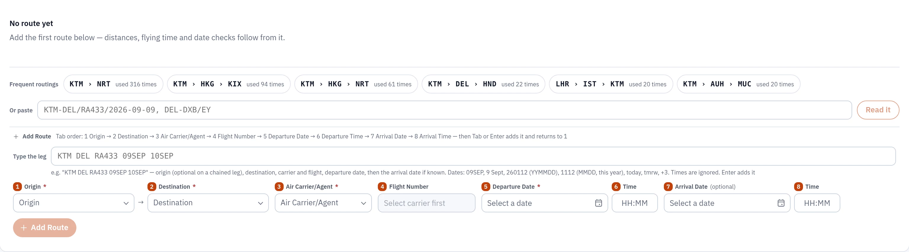
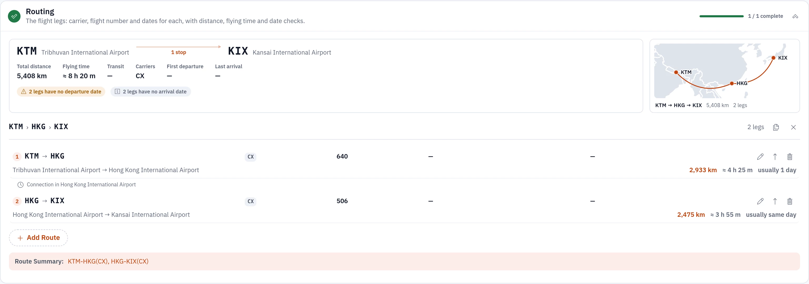

Entering an air waybill's routing used to mean six fields per flight leg: origin, destination, carrier, flight number, date, and again for the next leg. It was built like an authoring tool, as if every shipment invented a new journey.

Before redesigning it, I counted.

## The number that changed the design

Across 3,142 waybills there were 4,682 flight legs. Those legs described only **149 distinct routings**. The five most common covered **87% of all waybills**; the top twenty covered 94%. The single most common one, Kathmandu to Narita on one carrier's flight, appeared 1,728 times.

The same query found the mess that free entry creates: 9.4% of legs saved with no flight number, 8.6% with a zero-padded one ("0898" next to "898"), and five legs that landed before they took off.

So routing was never an authoring problem. It was a **recall** problem: the right answer was almost always one the office had already typed. That reframing is the whole design.

## From form to shortlist

The routing field now opens on an empty waybill with the office's most likely routings as chips.

 One click applies a whole multi-leg journey, with airport and airline names looked up fresh, so old free-text labels never come back. Pick an origin and destination and it hints the usual carriers, the usual flight and the median transit time for that lane.



One click fills every leg, and the field does the arithmetic people used to do in their heads: distance, flying time, where the connection is, and what's still missing before the waybill can go.

For people who'd rather type, a routing can be pasted as one line: `KTM-DEL(RA)`, `KTM-DEL/RA433/2026-09-09`, `KTM DEL RA 433 09SEP`. Codes resolve only on an exact IATA match. A guess here becomes a wrong flight on a legal document.

## Then it spread: a learning engine

Routings were the first field. The same idea, that an office's own history is the best predictor of its next entry, now runs across the waybill: a shipper's usual agent, issuer and bill-to, the HS codes for their goods, the consignee's notify party, the currency by destination. It also runs in quotes, rates and the carrier-portal automation.

There is **no machine-learning model**. Everything below is counting, done carefully.

### 1. Harvest, nightly

Each night, each organisation's saved records are read into its own private layer: values, the context they were used in, and how often. Nothing leaves the organisation's database.

### 2. Recent beats old

Every count decays with a 90-day half-life:

```
weight = uses × 0.5^(age_in_days / 90)
```

The routing a forwarder used 500 times two years ago, before an airline dropped the route, fades. The one it started using last month rises. Without decay, a learning system is a museum.

### 3. Suggest where people already type

Suggestions appear as grey text and chips in the fields people already use. There's no new screen and no "AI" button. The organisation's own values come first, always.

### 4. Judge at save, not per keystroke

When the form is saved, the browser reports, for each suggestion, whether it was **offered**, **taken**, **overridden** or **ignored**. One small payload with the normal save, never keystroke tracking.

### 5. Let the evidence decide, honestly

Each suggestion source earns or loses trust from those verdicts. The naive way is to look at the take rate: 2 of 5 is 40%, 200 of 500 is 40%. But those are not equally certain, and treating them the same promotes lucky guesses.

So the engine uses the **lower bound of the Wilson score interval** at 95% confidence:

```php
function wilsonLower(float $taken, float $offered, float $z = 1.96): float
{
    if ($offered <= 0) return 0.0;
    $p = $taken / $offered;
    $d = 1 + $z * $z / $offered;
    $c = $p + $z * $z / (2 * $offered);
    $m = $z * sqrt(($p * (1 - $p) + $z * $z / (4 * $offered)) / $offered);
    return ($c - $m) / $d;
}
```

At 2 of 5 the lower bound is about 0.12. At 200 of 500 it's about 0.36. A source whose lower bound clears 0.5 becomes **trusted** and is weighted up. One below 0.2 is **retired** and stops being offered. The counts decay too, so a source can earn its way back.

### 6. Share only what's safe to share

Some knowledge belongs to everyone: public codes, standard trade wording, common HS classifications. A weekly job harvests candidates across organisations into a staging area, and a value only qualifies if it appears in **at least three organisations and five waybills**. Anything shaped like a name, a phone number or an address is refused at harvest and checked again at load. Then a person reviews the result and commits it to the repository like code, so every deployment ships the same reviewed knowledge.

A company's customers, lanes and prices never leave it.

## What it taught me

1. **Count before you design.** The ratio of distinct values to rows tells you whether a field needs a better form or a shortlist.
2. **Recall beats prediction** when the past is this repetitive. Offering the office's own answers is faster and more trusted than generating new ones.
3. **Decay everything.** Business changes, and a learner that can't forget is wrong in slow motion.
4. **Measure acceptance with confidence, not ratios.** The Wilson lower bound is a few lines of code and stops small samples from looking certain.
5. **You often don't need a model.** Rules and counts over your own data, reviewed by people, go a very long way, and run with no data leaving the building.
